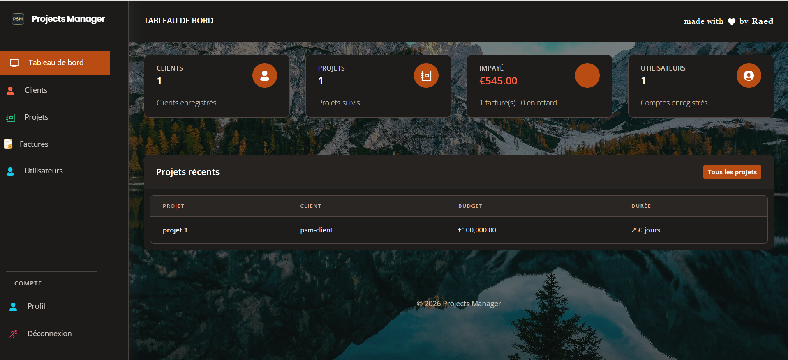

# PSM — Project Management System

PSM is a full-stack project management app built with Angular and Spring Boot. Manage clients, projects, teams, tasks, milestones, time entries, and invoices from one place.



## Features

- Dashboard with project, client, invoice, and team summaries
- Client and project management
- Project members, milestones, tasks, and task comments
- Time tracking and invoice management
- JWT authentication and role-based access
- Invoice and profile file uploads

## Tech stack

- **Frontend:** Angular 22, TypeScript
- **Backend:** Java 17, Spring Boot 4
- **Database:** MySQL for local development; SQLite in the Docker profile
- **Deployment:** Multi-stage Docker image; Render Blueprint included

## Run locally with MySQL

Requirements: Java 17+, Node.js/npm, and a local MySQL server.

1. Make sure MySQL is running. The backend connects to `localhost:3306` as `root` and creates the `psm` database if needed. Set `DB_PASSWORD` if your MySQL account uses a password.
2. Set the required runtime secrets and use port `2026` so the Angular proxy reaches the API:

   ```powershell
   $env:JWT_SECRET = "<a random secret of at least 32 characters>"
   $env:PSM_ADMIN_PASSWORD = "<a strong admin password>"
   $env:PORT = "2026"
   ```

3. Start the backend:

   ```powershell
   cd backend
   .\mvnw.cmd spring-boot:run
   ```

4. In a second terminal, start the frontend:

   ```powershell
   cd frontend
   npm ci
   npm start
   ```

Open [http://localhost:4200](http://localhost:4200). The Angular development server proxies API requests to the backend on port `2026`.

## Run the Docker image

The published image is [`raedaffes/projects-manager`](https://hub.docker.com/r/raedaffes/projects-manager). Configure secrets at runtime; they are not built into the image.

Create a local `.env.docker` from `.env.example`, set unique values for `JWT_SECRET` and `PSM_ADMIN_PASSWORD`, then run:

```powershell
docker run -d --name projects-manager `
  --env-file .env.docker `
  -p 2026:2026 `
  -v psm-data:/var/lib/psm `
  raedaffes/projects-manager:latest
```

Open [http://localhost:2026](http://localhost:2026). The Docker profile uses SQLite and stores its database and uploaded files under `/var/lib/psm`; the named volume keeps them across container recreation.

For Render, deploy with the included `render.yaml` Blueprint or set `JWT_SECRET` and `PSM_ADMIN_PASSWORD` in the service's Environment settings. Keep secrets out of source control and container images.

## Build and test

```powershell
cd backend
.\mvnw.cmd test

cd ..\frontend
npm run build
```
